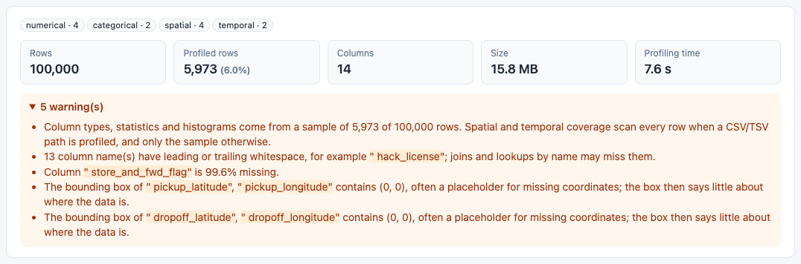
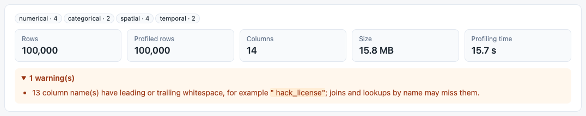
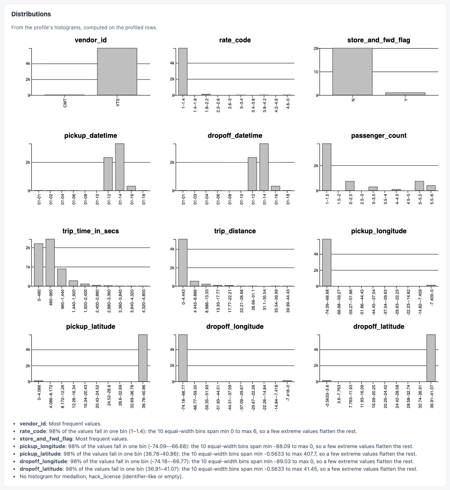
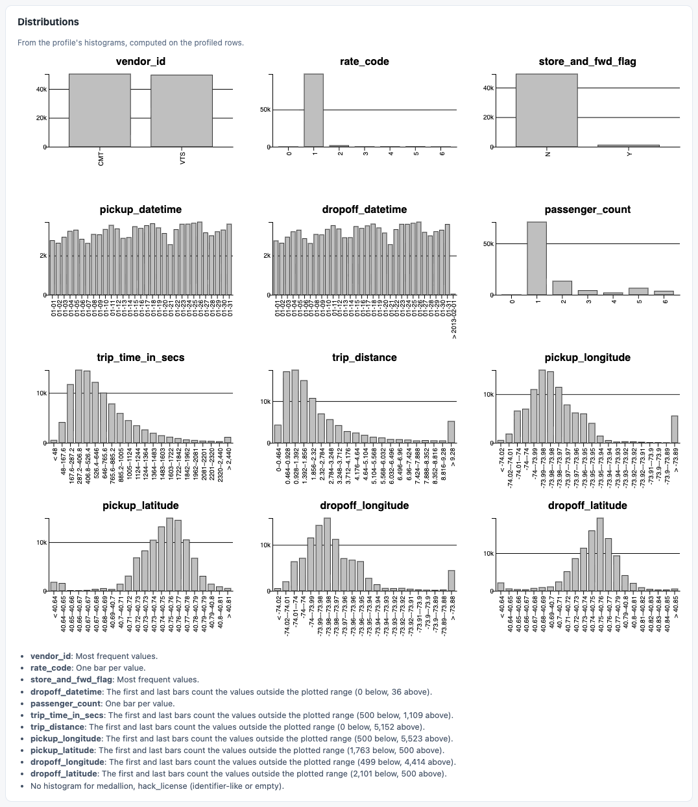
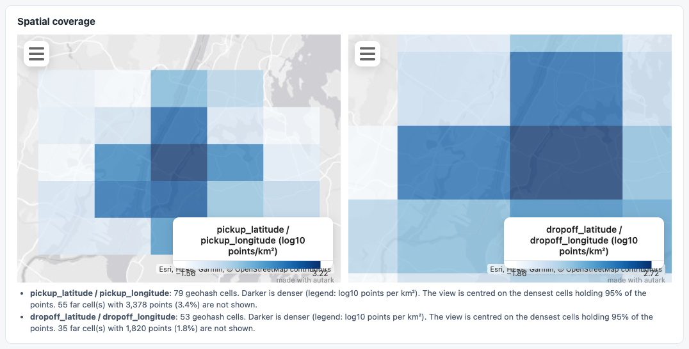
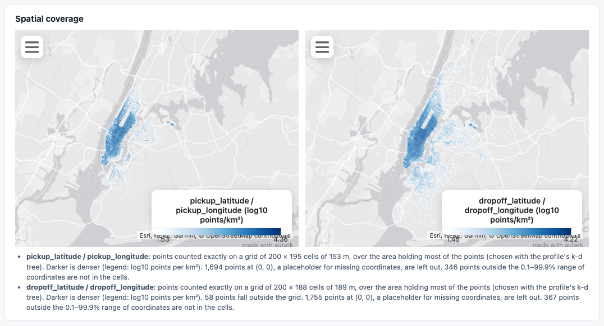
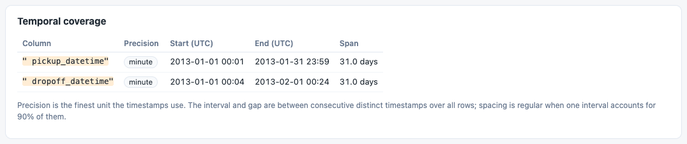
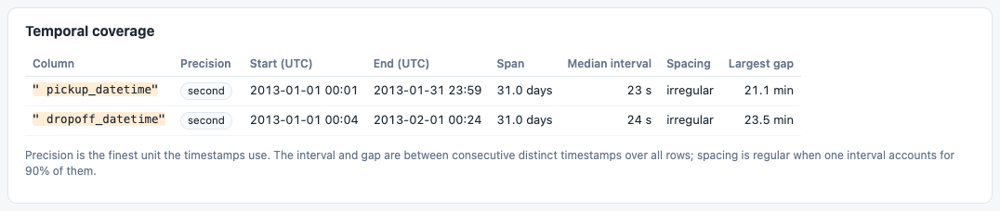

# How the profiler changed

This page compares how Atlas Profiler worked before these changes (the `main` branch at `b449447`) with how it works now. Everything below was measured on the 2013 NYC taxi trip records released under a FOIL request (January: 14,776,615 trips in a 2.3 GB CSV) and on a 100,000-trip random sample of that file.

The images are sections of the HTML profile report (`profiler.report`, documented in `docs/report.md` on the report branch). The report draws each profile as it is, so the **before** and **after** images are the same file profiled by the old code and by the new code.

## At a glance

| | Before | Now |
|---|---|---|
| Rows profiled from a CSV | The first rows of the file | A seeded random sample across the whole file |
| How many rows | As many as fit in 5 MB of pandas memory (5,973 taxi rows) | Adapts to the table: about 2 million values, at least 10,000 rows |
| All of January | Stopped after more than 10 minutes, still in the temporal step | 57 seconds |
| polars | Failed on polars 2.x | Works on polars 1.44 and 2.x |
| Numeric histograms | 10 equal-width bins from min to max | 20 bins over a robust range, with counts below and above it; one bar per value for small integer domains |
| Time histograms | 10 equal-width bins | Calendar bins (hour, day, month or year) |
| Spatial summary | Up to 100 geohash cells; a bounding box from min/max | An exact density grid of square cells about 150–200 m across for a city, chosen with a k-d tree; (0, 0) placeholders and stray points counted apart; geohash cells kept, same format |
| Time summary | Range and `temporal_resolution` | Also `temporal_precision` and a `sampling` summary (typical interval, regularity, largest gap) |
| Which numbers come from the sample | Not recorded | `computed_on` |
| `import atlas_profiler` | 2.3 s, loads PyTorch | 0.85 s; PyTorch loads only if the spatial classifier runs |

## Sampling

**Before.** For a CSV path, the profiler read the file's first *n* rows, although its documentation said the data was randomly sampled (a DataFrame was sampled randomly). *n* was set by `load_max_size`, a budget of 5 MB of pandas memory by default. A taxi row takes about 840 bytes as pandas string objects, so 5,973 rows: 0.04% of January, all from the start of the file. The time histograms showed almost every trip on January 12–16, and `store_and_fwd_flag` looked 99.6% missing because those rows came almost all from one vendor.

**Now.** Row numbers are drawn at random with a fixed seed, so a profile is reproducible, and the rows are read while streaming through the file (`_sample_csv_rows`). The sample size adapts to the table (`profiled_rows`): about 2,000,000 values (rows × columns), at least 10,000 rows, at most 256 MB of in-memory data, and never more rows than the table has. That is 142,857 rows for the 14 taxi columns. Passing `load_max_size` keeps the old byte budget. On the same sample file, `store_and_fwd_flag` is now 50.4% missing, which matches the 49.7% measured over every row of January.

The profile now says what comes from where, in `computed_on`. Column types, value ranges and histograms come from the sample. Distinct counts, numeric statistics, and spatial and temporal coverage come from every row of a CSV file (for a DataFrame, only distinct counts do).

Before: the sample is the top of the file and the warnings could not say exactly what it affected.

Now:

## Speed

| Step, all of January | Before | Now |
|---|---|---|
| Load: statistics over every row, and the sample | 19 s | about 18 s |
| Column processing | about 1 s (5,973 rows) | about 16 s (142,857 rows) |
| Spatial coverage | 70 s | about 9 s |
| Temporal coverage | about 5 min per date column | about 9 s |
| **Total** | **stopped after 10+ minutes** | **57 s** |

- **Temporal coverage.** For a CSV, the extent of a date column is its true min and max over every row. Before, each of the 14.8 million timestamps was parsed in Python with `dateutil`, twice per value. Now polars parses the column natively. Its answer is used only if it parsed every value and agrees with the exact parser on the first 200 values, which rules out a day/month mix-up (01/02 read as February 1) and partial dates such as "June 2020". Otherwise the profiler falls back to the exact parse, so results do not change.
- **Spatial coverage.** Before, every point was added to a geohash tree one at a time in Python. Now the geohash cells, the k-d tree and the grid are computed with numpy over whole arrays (`profiler/spatial_index.py`). The geohash cells are identical to the old `Geohasher`'s, including points that lie exactly on cell boundaries.
- **Column processing** is slower because the sample is 24 times larger; its cost follows the sample size.
- **Import.** The spatial classifier's PyTorch code moved to `profiler/geo_model.py` and is imported when the classifier runs. `profiler.spatial` still provides the same names.

## polars versions

polars 2 removed two `scan_csv` options that the CSV path used: `rechunk`, which was already the default, and `missing_utf8_is_empty_string`, which reads missing fields as empty strings instead of nulls. Type detection relies on the latter. With polars 2, nulls are now filled with empty strings right after the scan, which gives the same frame. The requirement is `polars>=1.44`; profiles of the taxi sample are identical under polars 1.44 and 2.1, apart from timings.

## Histograms

**Before:** 10 equal-width bins from the column's min to its max. A few extreme values, such as a 95-mile trip, a latitude of 407 or coordinates at (0, 0), put almost every value into one bin.

**Now** (`profiler/histograms.py`):

- **Numbers:** 20 bins over a robust range: the 0.5–99.5% range, narrowed to three interquartile ranges around the quartiles. Placeholders such as (0, 0) can be a few percent of the values, more than percentiles alone would trim. Values outside the range are counted in `below` and `above`.
- **Integer columns with at most 20 distinct values** get one bar per value (`discrete: true`).
- **Times:** calendar bins (hour, day, month or year, depending on the span) over the 0.5–99.5% range, with the unit in `unit`.

The histograms still come from the profiled sample, which is now random and much larger.

## Spatial coverage

**Before.** Each lat/long pair had a bounding box from the raw min and max of its points, and up to 100 base-4 geohash cells (`geohashes4`). Coordinates at (0, 0), a common placeholder for missing ones, were kept, so the taxi pickups' box ran from −88° to 0° longitude. The geohash tree keeps at most 100 cells per level, and stray points scattered over the world use up that budget at every fine level. On the sample that left cells several kilometres wide; on all of January the tree stopped at cells of about 11° × 6°, and one cell held 99.97% of the trips.

**Now:**

- **(0, 0) points** are left out and counted in `number_zero_coordinates`.
- **The bounding box** spans the 0.1–99.9% quantiles of each coordinate, not the raw min and max. Points outside it are counted in `number_outside_envelope`.
- **Geohash cells** (`geohashes4`, same format as before) are built from the points inside that box, so stray points no longer coarsen them.
- **A k-d tree** (`kdtree`) partitions the points by median splits, after the index TaxiVis builds for taxi trips. Each node is split across its longer side in kilometres, which keeps cells close to square; TaxiVis instead cycles through its keys. Every leaf holds about the same number of points: 4,096 leaves by default (`spatial_leaves`), so leaves are small where the data is dense and large where it is sparse.
- **A density grid** (`grid`) counts the points exactly in square cells on the ground, 200 cells along the longer side of the area holding most of the data. The k-d tree chooses that area: the densest leaves holding 95% of the points, grown by 25% on each side. Each point is counted in the one cell that contains it; points outside the grid are counted in `outside`. For January that gives cells of 166 m for pickups and 182 m for dropoffs, and the avenues, bridges and airports show.

## Temporal coverage

**Before:** each date column's range and a `temporal_resolution`. That resolution is the finest calendar unit that keeps the *sampled* timestamps apart, so it depends on how dense the sample is: the same taxi file gave `minute` from the first rows and `second` from a random sample.

**Now:** `temporal_resolution` is unchanged (other tools may rely on it), and each entry also has:

- `temporal_precision`: the finest unit the timestamps actually use (a time with non-zero seconds is at `second` precision), independent of the sample.
- `sampling`: how the timestamps are spaced, computed over every timestamp of a CSV column (or of a DataFrame that was not sampled, since a sample spaces timestamps further apart than the data does): the number of distinct timestamps, the median, 10th and 90th percentile intervals, the most common interval and its share (`regular` when it accounts for 90% of the intervals), the number of gaps over ten times the median, and the largest gap with its start.

For all of January, pickups have a median interval of 1 second and a largest gap of 27 seconds: trips start every second of the month.

## Columns

- **Values are stripped.** In files written with ", " between fields, every value starts with a space. Type detection saw `" 40.7"` as text, so without the spatial classifier numbers were typed as Text and their coordinates were silently dropped from the spatial coverage. The sample and the coordinate step now strip values, as the whole-file statistics already did.
- **Hashed identifiers.** Text columns of many same-length tokens of hex digits, or of mixed letters and digits (the taxi `medallion` and `hack_license`), are marked as identifiers.
- **Distinct counts** of CSV columns are approximate (HyperLogLog); they are now recounted exactly when there are at most 10,000 values, and `num_distinct_values_is_approximate` is always present for CSV columns.
- **Keywords.** `attribute_keywords` are built from stripped names and have no duplicates (before, `' hack_license'` appeared next to `hack_license`). Column names themselves are kept as they are in the file.

## Inputs and privacy

- **Inputs.** `os.PathLike` paths are accepted (before: `TypeError`). A `delimiter` option covers file objects and paths (before, a TSV file object was read as one column). DataFrame column labels are converted to strings and duplicates renamed `name`, `name.1`, … (before, integer labels raised an exception). A column annotated as a date with no parseable values is skipped (before: `KeyError`).
- **Finite numbers only.** Whole-file statistics of a CSV now accept the same numbers as the sample, finite and within the float32 range, so `nan` and `inf` in a file never reach the profile; profiles serialize as strict JSON (`json.dumps(..., allow_nan=False)`).
- **No data values written by default.** Before, every call with the spatial classifier appended sampled values of each spatial column to `output/geo_classifier_results.csv` in the current directory, and INFO logs printed them, along with k-means cluster centres. Now that file is written only to an explicit `diagnostics_path`, classifier logs keep to the column name, label, confidence, and source, and the cluster logs are at DEBUG level.
- **Missing classifier dependencies** give a clear error that says how to install them or to pass `geo_classifier=False`.

## Histograms over every row

`full_statistics=True` (with `plots=True`) recomputes each histogram over every row instead of the profiled sample: numbers and times with polars for a CSV path or pandas for a DataFrame, and exact most-frequent values for categories. Dates are parsed in bulk only when the result agrees with the exact parser; a column that cannot be (day-first dates such as 02/01/2013) keeps its sample histogram, and the profile says `mixed`. Each histogram records its own `computed_on`. For all of January this adds 14 s (73 s instead of 57 s), and every histogram covers all 14,776,615 trips.

## Profile fields, new and changed

| Field | Where | Meaning |
|---|---|---|
| `computed_on` | profile | How rows were sampled (`sampling`), and whether each part comes from the `sample`, `all_rows`, or is `mixed` |
| `computed_on` | each spatial and temporal coverage entry, each histogram (`full_statistics`) | The same, for that entry |
| `number_zero_coordinates` | spatial coverage | Points at (0, 0), left out |
| `number_outside_envelope` | spatial coverage | Points outside the 0.1–99.9% bounding box |
| `kdtree` | spatial coverage | `leaves`: `bounds` (min lon, min lat, max lon, max lat) and `number`; `split`, `max_leaves` |
| `grid` | spatial coverage | `bounds`, `columns`, `rows`, `cell_degrees`, `cell_km`, `outside`, and `cells` as `[column, row, count]` for non-empty cells |
| `ranges` | spatial coverage (CSV) | Now the 0.1–99.9% quantile box instead of min/max |
| `temporal_precision`, `sampling` | temporal coverage | See [Temporal coverage](#temporal-coverage) |
| `below`, `above`, `discrete`, `unit` | `plot` | See [Histograms](#histograms) |
| `num_distinct_values_is_approximate` | column | Now `false` when the count was recounted exactly |

New parameters: `spatial_leaves` (k-d tree leaves, 4096), `full_statistics`, `diagnostics_path`, and `delimiter`. The default of `load_max_size` changed from a 5 MB budget to the adaptive sample size; pass `load_max_size=5000000` for the old behavior.
