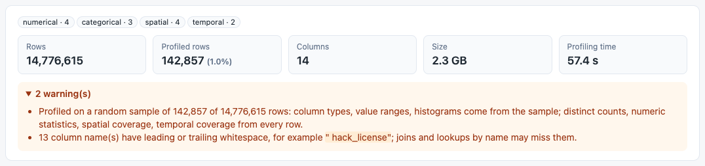
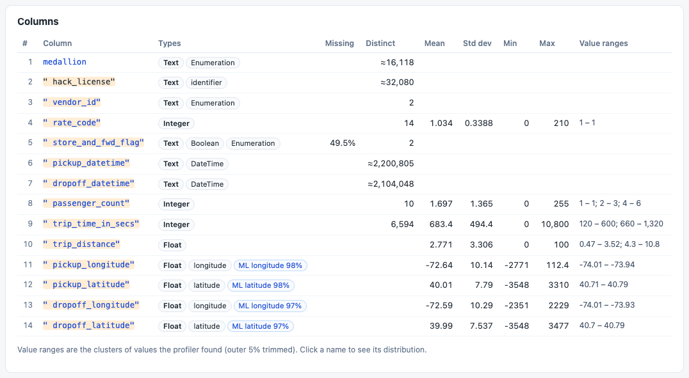
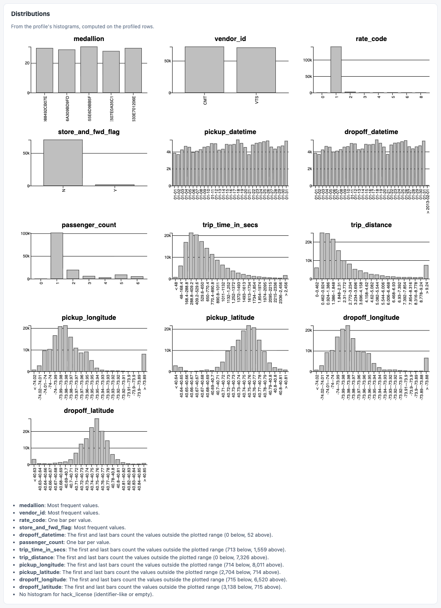
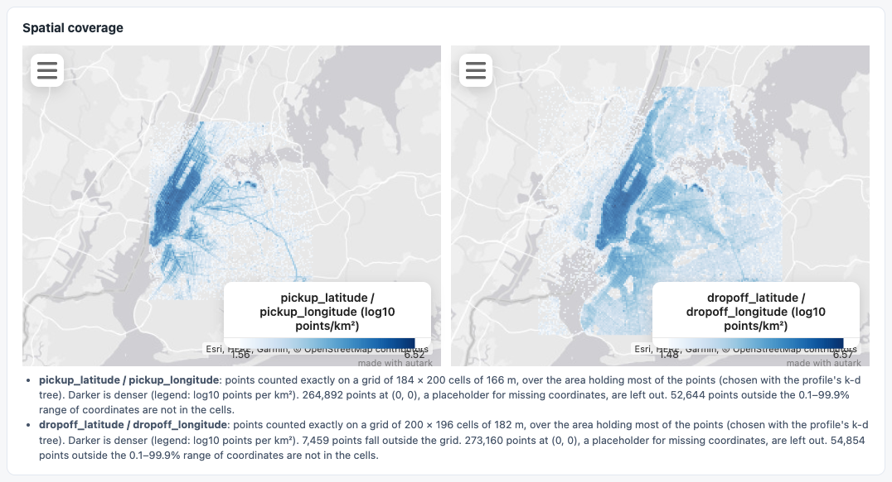
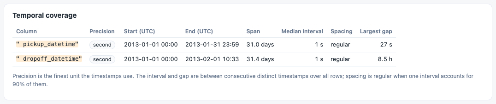
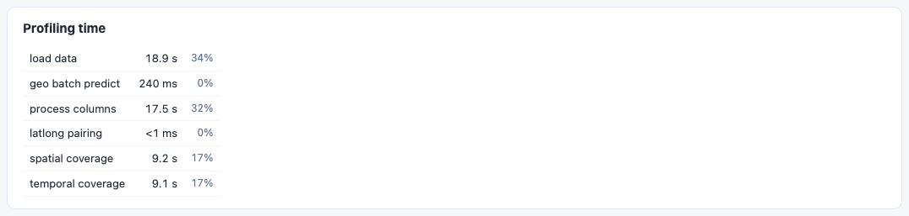

# Profile report

`profiler.report` turns a profile into a standalone HTML page. A profile is the dictionary `process_dataset` returns, or the JSON it was saved to. The page summarizes the dataset, lists its columns, and draws the distribution of every column and maps of its spatial coverage. Everything comes from the profile: the data is not read again, so a report of a 2.3 GB file takes a second.

The charts and maps are drawn with [Autark](https://autarkjs.org/) through [pyautark](https://github.com/urban-toolkit/autark), its Python API. The rest of the page is plain HTML.

The images below are from the report of all 14.8 million trips of January 2013 in the NYC taxi trip records (FOIL 2013).

## Making a report

From Python:

```python
from atlas_profiler import process_dataset, ProfileReport

metadata = process_dataset("trip_data_1.csv", plots=True)   # plots=True adds the histograms
ProfileReport(metadata, title="Taxi trips, January 2013").save("report.html")

# or from a profile saved as JSON
ProfileReport.from_json("trip_data_1.profile.json").save("report.html")
```

In Jupyter, a `ProfileReport` displays inline:

```python
ProfileReport(metadata)
```

From the command line:

```bash
python -m profiler.report trip_data_1.profile.json -o report.html --title "Taxi trips, January 2013"
# or, once the package is installed
atlas-profiler-report trip_data_1.profile.json
```

### Requirements

- **pyautark** (`import autark`), which is not on PyPI yet. Install it from its repository (the `python/` folder), or add that folder to the Python path.
- **A browser with WebGPU** (a recent Chrome, Edge or Safari) to see the maps. The rest of the page works in any browser.
- **Network access when the page is opened,** for the basemap tiles and for the files of Autark's in-browser database (DuckDB), which pyautark's standalone page loads from a CDN.

## What the page shows

A bar at the top links to each section and stays in place as you scroll.

### Overview

Row and column counts, the share of rows that were profiled, file size and profiling time, the column type counts, and warnings found in the profile. The warnings cover:

- what was computed on the profiled sample and what on every row (from the profile's `computed_on`)
- column names with leading or trailing spaces
- columns that are mostly missing
- spatial bounding boxes that include (0, 0)



### Columns

One row per column: structural and semantic types (including the spatial classifier's labels and confidence), share of missing values, number of distinct values (`≈` when approximate), mean, standard deviation, min, max, and the value ranges the profiler found. A column name links to the distributions.



### Distributions

One histogram per column that has one in the profile, three per row. They are Autark bar charts (autk-plot).

- **Numbers:** bins over the robust range the profiler chose, with a first and a last bar counting the values below and above it.
- **Small integer domains** (such as `passenger_count` or `rate_code`): one bar per value.
- **Times:** calendar bins (here, one bar per day of January).
- **Text and categories:** the most frequent values.

The notes under the charts say how each histogram was made. Profiles made before the robust histograms have 10 equal-width bins from min to max, and for those the notes say when a few extreme values flatten a histogram.



### Spatial coverage

One Autark map (autk-map) per lat/long pair, side by side, over a light-gray basemap. Each map draws the profile's density grid: square cells on the ground, with the points counted exactly in the cell that contains them, colored by log₁₀ of points per km². Here the cells are 166 m for pickups and 182 m for dropoffs. All maps open at the same zoom, the one that shows the largest of their areas, so they can be compared at a glance. The captions give the grid size, and how many points were left out: at (0, 0), outside the 0.1–99.9% coordinate range, or outside the grid.

Profiles without a density grid show their geohash cells instead, centered on the densest cells that hold 95% of the points.



### Temporal coverage

For each date or time column: its precision (the finest unit the timestamps use), start and end in UTC, the span, and, when the profile has it, the median interval between consecutive distinct timestamps, whether the spacing is regular, and the largest gap.



### Profiling time

The time of each profiling step and its share of the total.



## How it is built

`profiler/report.py` turns the profile into Autark data sources and views with pyautark:

- an `ak.Barchart` for each histogram, in a 3-column `ak.Layout(type="grid")`
- an `ak.Map` for each lat/long pair, with the grid cells as an inline `ak.GeoJSON` source colored by `log_density`, an `ak.Basemap`, and an `ak.Camera` zoom

pyautark writes these as an UrbanSpec, and its runtime (autk-grammar, with autk-db, autk-plot and autk-map) draws them in the browser. Each of the two groups (distributions, maps) is a pyautark standalone page, from `ak.to_embedded_html`, embedded in the report in an `iframe`. The overview and the tables are HTML.

Things the report works around, worth fixing upstream:

- **Plots need tables with a geometry.** Autark reads every table through its spatial database, which only takes tables with a geometry. Each histogram table carries placeholder point coordinates (`_lat`/`_lon`) that no map draws.
- **Maps keep their first size.** Autark sizes a map's drawing buffer when the map starts and afterwards only on a window resize. In pyautark's layout the map starts before its frame has its final size and would be drawn squashed, so each embedded page sends a window resize event when a canvas changes size.
- **No way to turn off cell borders from pyautark.** Thousands of small cells would be drawn as solid outlines. The report sets UrbanSpec's `stroke: false` on the map layers by editing the spec dictionary, which `to_embedded_html` also accepts.
- **The camera does not fit the data.** autk-grammar puts the camera `10000 / 2 ** (zoom - 10)` metres above the centre of the map's data, so the report computes the zoom that shows each grid.
- **Axis ticks.** autk-plot used D3's default of about ten ticks per axis, which crowds small histograms. The `feat/plot-axis-ticks` branch of Autark scales the tick count with the axis length; until it is released, a pyautark bundle built against it is needed for the sparser axes.

## Size

The page embeds pyautark's runtime (about 2 MB) once per embedded view, and the data as inline GeoJSON. A report of the 100,000-trip sample is about 7 MB. The report of all of January is about 16 MB, mostly its two density grids of 10,391 and 18,492 cells.
